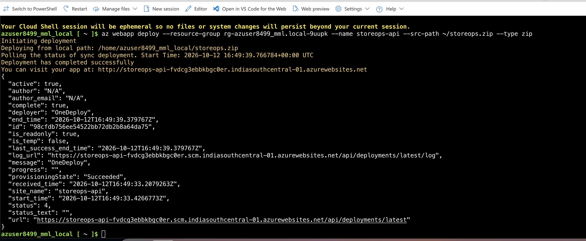
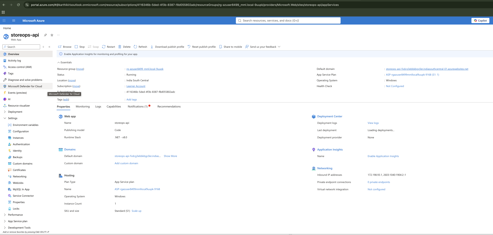
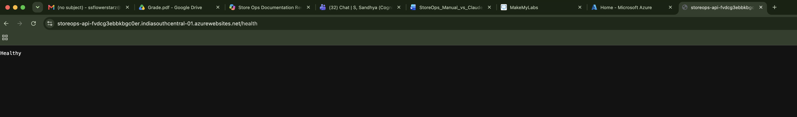
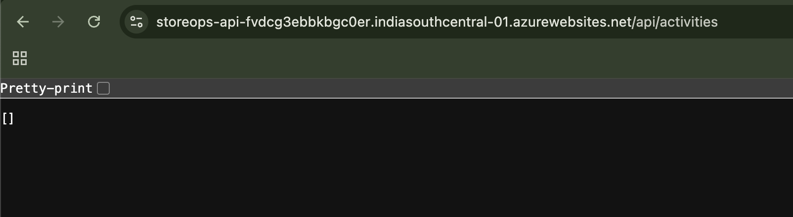
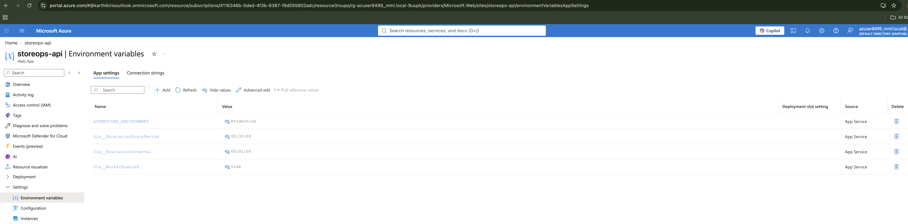
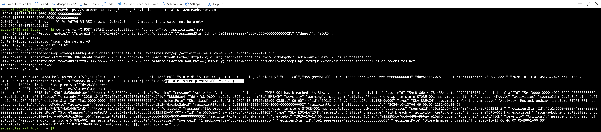

# DEPLOYMENT: StoreOps API (FEAT-sla-breach-alerting)

## 1. Deployment target

**Azure App Service** (cloud deployment, accepted by the brief §3.4).

| Item | Value |
|---|---|
| Service | Azure App Service, Web App `storeops-api`, publishing model *Code* |
| Plan | Windows, Standard S1, one instance, India South Central |
| Runtime | .NET 8 (shown in the portal as ".NET - v8.0") |
| Subscription | Azure "Learner Account" |
| Live URL | `https://storeops-api-fvdcg3ebbkbgc0er.indiasouthcentral-01.azurewebsites.net` |

**Why not Docker.** The build machine has no Docker runtime (`docker --version`: command not found; recorded in JOURNAL.md, Decision 001). The `Dockerfile` in the repository root is provided but was **not built or run**, so this submission makes no Docker claim.

**Availability.** The URL belongs to a learner subscription and may stop responding once that subscription is retired. The deployment evidence below was captured on 2026-10-12, and the endpoints and the SLA flow (section 4) were run on 2026-10-13.

## 2. Steps taken

1. **Build and test the final code** (commit `9a14312`; the final `HEAD` also contains documentation commits):
   `dotnet build StoreOps.sln` gave 0 warnings and 0 errors; `dotnet test StoreOps.sln` gave 94 passed, 0 failed, 0 skipped (SDK 8.0.425, as pinned in `global.json`).
2. **Publish and package** (framework-dependent, Release):
   ```bash
   dotnet publish src/StoreOps.Api/StoreOps.Api.csproj -c Release -o <tmp>/pub
   (cd <tmp>/pub && zip -qr storeops.zip .)
   ```
   The zip holds 12 files at its root, including `StoreOps.Api.dll`, `appsettings.json` and `web.config` (IIS in-process hosting for App Service).
3. **Azure portal.** Opened the existing resource group `rg-azuser8499_mml.local-9uupk`, then created the Web App: Publish *Code*, runtime stack .NET 8, Windows, plan Standard S1, Application Insights off.
4. **App settings** (Settings → Environment variables, shown in Figure 5), plus *General settings* with Always on and HTTPS only both enabled:

   | Setting | Value |
   |---|---|
   | `ASPNETCORE_ENVIRONMENT` | `Production` |
   | `Sla__WorkerEnabled` | `true` |
   | `Sla__EscalationGracePeriod` | `00:30:00` |
   | `Sla__EvaluationInterval` | `00:01:00` |

5. **Deploy the zip** from the portal's Cloud Shell (Bash):
   ```bash
   az webapp deploy --resource-group rg-azuser8499_mml.local-9uupk --name storeops-api --src-path ~/storeops.zip --type zip
   ```
   Result: `Deployment has completed successfully`, `deployer: OneDeploy`, `provisioningState: Succeeded`, start `2026-10-12T16:49:33Z`.

## 3. Evidence of the running deployment

**Figure 1: Deployment succeeded.** Cloud Shell output of `az webapp deploy`: deployment completed, `provisioningState: Succeeded`, site `storeops-api`.



**Figure 2: App Service running.** Portal Overview: Status **Running**, India South Central, Windows, Standard S1, runtime .NET v8.0, with the default domain.



**Figure 3: Health endpoint.** Browser at `…azurewebsites.net/health` returns `Healthy`.



**Figure 4: Activities endpoint.** Browser at `…azurewebsites.net/api/activities` returns `[]` (an empty list, because the in-memory store starts empty).



**Figure 5: App settings with values.** Portal → Settings → Environment variables for `storeops-api`, with the values shown: `ASPNETCORE_ENVIRONMENT` = `Production`, `Sla__EscalationGracePeriod` = `00:30:00`, `Sla__EvaluationInterval` = `00:01:00`, `Sla__WorkerEnabled` = `true`. The "Deployment slot setting" column is empty because no deployment slots are used.



**Terminal checks** against the live URL (read-only requests, last run on 2026-10-13):

```
GET  /health                                  -> 200  Healthy
GET  /api/activities                          -> 200  []
GET  /api/alerts                              -> 200  []
GET  /api/alerts?recipientStaffId=not-a-guid  -> 400
     {"code":"VALIDATION_FAILED","message":"The request is invalid.","statusCode":400,
      "details":{"recipientStaffId":["The value 'not-a-guid' is not valid."]}}
```

The last request exercises the Sprint 7 alert filter (REQ-12) and the typed error contract (`AppError` → `VALIDATION_FAILED`) in the deployed build.

## 4. SLA breach alerting: verified on Azure

The complete flow (overdue activity, breach alert, escalation alert, no duplicates) was run against the live Azure URL on 2026-10-13, with the background worker enabled (`Sla__WorkerEnabled=true`, evaluation interval one minute). The commands were typed in a terminal on the developer's Mac, but every request went to the Azure host. The response headers show it: `Server: Microsoft-IIS/10.0`, a `Location` header on the `azurewebsites.net` host, and the App Service `ARRAffinity` cookie. **No evaluation call was made between creating the activity and reading the alerts**, so the alerts below were created by the worker on its own.

Output (times are UTC; `ARRAffinity` cookies and unrelated fields trimmed, `…` marks omissions):

```
### 1 create an overdue Critical activity  (POST /api/activities, dueAt = one hour earlier)
HTTP/1.1 201 Created
Server: Microsoft-IIS/10.0
Location: https://storeops-api-fvdcg3ebbkbgc0er.indiasouthcentral-01.azurewebsites.net/api/activities/2bc6d3b6-c14e-4a6f-ad0c-63ca284e4f56
{"id":"2bc6d3b6-c14e-4a6f-ad0c-63ca284e4f56","title":"Restock endcap","storeId":"STORE-001","status":"Pending",
 "priority":"Critical","dueAt":"2026-10-13T05:51:27+00:00","createdAt":"2026-10-13T06:51:27.2355665+00:00", …}

(waited 80 seconds; no evaluation request sent)

### 2 GET /api/alerts?recipientStaffId=<ShiftLead 5e1f0000-0000-4000-8000-000000000002>
{"id":"bbb5dae4-f766-4fc8-9c09-4fe9b0c4b375","type":"SLA_BREACH","severity":"Warning",
 "message":"Activity 'Restock endcap' in store STORE-001 has breached its SLA.","sourceModule":"activities",
 "sourceId":"2bc6d3b6-c14e-4a6f-ad0c-63ca284e4f56","recipientStaffId":"5e1f0000-0000-4000-8000-000000000002",
 "recipientRole":"ShiftLead","createdAt":"2026-10-13T06:52:09.0385117+00:00"}

### 3 GET /api/alerts?recipientStaffId=<StoreManager 5e1f0000-0000-4000-8000-000000000001>
{"id":"ef5650da-f649-4a1a-b248-70a5e8b14203","type":"SLA_ESCALATION","severity":"Critical",
 "message":"SLA breach of activity 'Restock endcap' in store STORE-001 has escalated.","sourceModule":"activities",
 "sourceId":"2bc6d3b6-c14e-4a6f-ad0c-63ca284e4f56","recipientStaffId":"5e1f0000-0000-4000-8000-000000000001",
 "recipientRole":"StoreManager","createdAt":"2026-10-13T06:52:09.0388278+00:00"}

### 4 POST /api/activities/sla-evaluations  (manual evaluation after the worker)
{"evaluatedAt":"2026-10-13T06:52:47.7045435+00:00","newlyBreached":[],"newlyEscalated":[]}
```

What this shows:

- **Automatic detection:** the alerts were created at 06:52:09, 42 seconds after the activity (06:51:27), by the background worker.
- **Breach and escalation in one pass:** the activity was an hour past due, beyond the 30-minute grace period, so both alerts carry the same worker tick (AC-4.08).
- **Right recipients:** the breach alert goes to the store's ShiftLead (the Department Lead, spec ASM-03) and the escalation alert to the StoreManager, with the severities `Warning` and `Critical` (ASM-05).
- **No duplicates:** the later manual evaluation reports nothing new, so each stage was reached once.
- **Earlier run:** the same sequence had been run about five minutes before (alerts created at 06:46:09), so each alert list also holds an older pair for a second activity (`1fa9d2bb-9fd0-4ddc-a2c3-f9aeabe2abcd`). It is omitted above. It does not change the result for the activity shown.

**Reproduced from Azure Cloud Shell (Figure 6).** The same sequence was repeated on 2026-10-13 from the portal's Cloud Shell (Bash), which runs inside Azure. A new overdue Critical activity (`59c816d0-4178-4384-bdfc-097991213f5f`, created 07:05:23 UTC, `dueAt` 06:05:11) returned `201 Created`. The worker then created an `SLA_BREACH` alert for the ShiftLead (`09bbab9b-7818-4dfe-93df-8a5d00bd4a04`) and an `SLA_ESCALATION` alert for the StoreManager (`892d4b2b-6c83-4ac7-b7b7-bd144b714d5f`) at about 07:06:09, 46 seconds after the activity and without any evaluation request. A manual evaluation at 07:07:27 returned `"newlyBreached":[],"newlyEscalated":[]`. The alert lists also show the older pairs from the earlier runs. (A first Cloud Shell attempt used the macOS-only `date -v` option, so its activity was rejected with `400 VALIDATION_FAILED`; the successful run below used `date -d`.)



Further verification of the same build:

- **Automated tests:** the 94 tests include one test per testable acceptance criterion (the "gate" ACs are checked by the build, test and architecture commands instead), all passing. Alert creation, deduplication, escalation and the worker are covered by `SlaEvaluationEndpointsTests`, `SlaEvaluationWorkerTests` and `SlaAlertsEndpointsTests`.
- **Local run** (2026-10-11, Production mode, worker off so that evaluation ran only on request): `POST /api/activities/sla-evaluations` returned the activity in both `newlyBreached` and `newlyEscalated`, a second evaluation returned empty lists, and the two alerts matched the Azure result.

## 5. Mapping to the feature prompt (PROMPT.md)

| Requirement | Where verified |
|---|---|
| HIGH/CRITICAL activity past due and not done publishes a breach | tests AC-2.x and AC-3.x; Azure run (worker-created `SLA_BREACH`) |
| Alert for the Department Lead (the store's ShiftLead) | tests AC-6.01, AC-6.02; Azure run (`SLA_BREACH`, `ShiftLead`) |
| Escalate to the Store Manager after the grace period | tests AC-4.x, AC-6.03; Azure run (`SLA_ESCALATION`, `StoreManager`) |
| No duplicate alert for the same stage | tests AC-2.05, AC-2.06, AC-6.04; Azure run (later evaluation empty) |
| Typed error behaviour | tests AC-7.02; Azure and local `400 VALIDATION_FAILED` |
| Controller → Service → Repository, `IEventBus`, `AppError` | architecture tests (18/18) in every sprint's evaluator feedback |

## 6. Limitations

- **In-memory state** (spec OOS-08): restarting the app, or changing app settings, clears activities, alerts and SLA stages. Keep a single instance, because a second one would repeat breaches.
- **No authentication:** the endpoints accepted every request in these checks without credentials, so the public URL is open.
- **Environment:** Swagger is off (Production), no health-check path or Application Insights is configured in the portal, and the plan is Windows S1, which uses learner credit while running.
- **Docker:** the `Dockerfile` is unverified. Its build stage uses `mcr.microsoft.com/dotnet/sdk:8.0` while `global.json` pins 8.0.425, so pin the image tag before using it.
